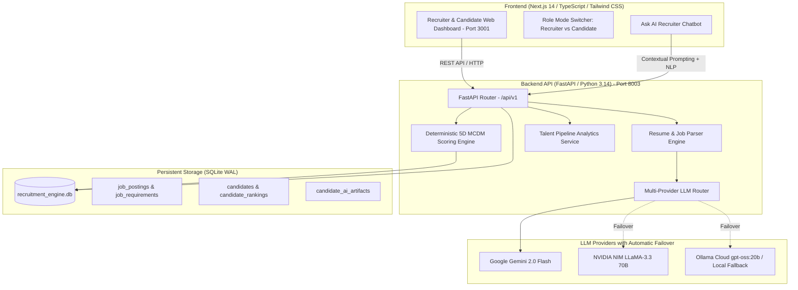

# Architecture & System Topology: TalentRec AI Recruitment Engine

High-level architecture, data flow, scoring mathematical pipeline, and technology integration patterns for the Recruitment Recommendation Engine.

---

## 1. System Topology Diagram

---

## 2. Deterministic 5-Dimension Scoring Formula (MCDM)

Rather than asking an LLM to generate an unexplained arbitrary ranking, the engine calculates deterministic scores in Python:

$$\text{FinalScore} = \left( 0.40 \times S_{\text{skills}} + 0.25 \times S_{\text{exp}} + 0.15 \times S_{\text{qual}} + 0.15 \times S_{\text{proj}} + 0.05 \times S_{\text{domain}} \right) - P_{\text{mandatory}}$$

* **Mandatory Penalty Gate ($P_{\text{mandatory}}$)**: If a mandatory skill is missing, $P_{\text{mandatory}} = 30$, preventing unqualified profiles from outranking candidates who satisfy critical core prerequisites.
* **Demographic Blinding**: Pre-review sanitization strips candidate full name, phone number, and email, replacing them with anonymous codes (`CAND-001`, `CAND-002`) to comply with the DPDP Act 2025.

